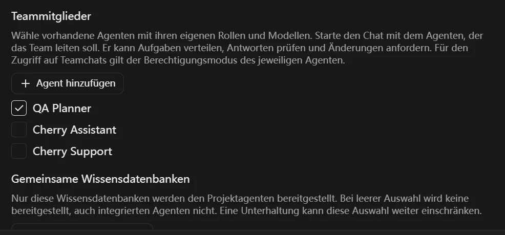
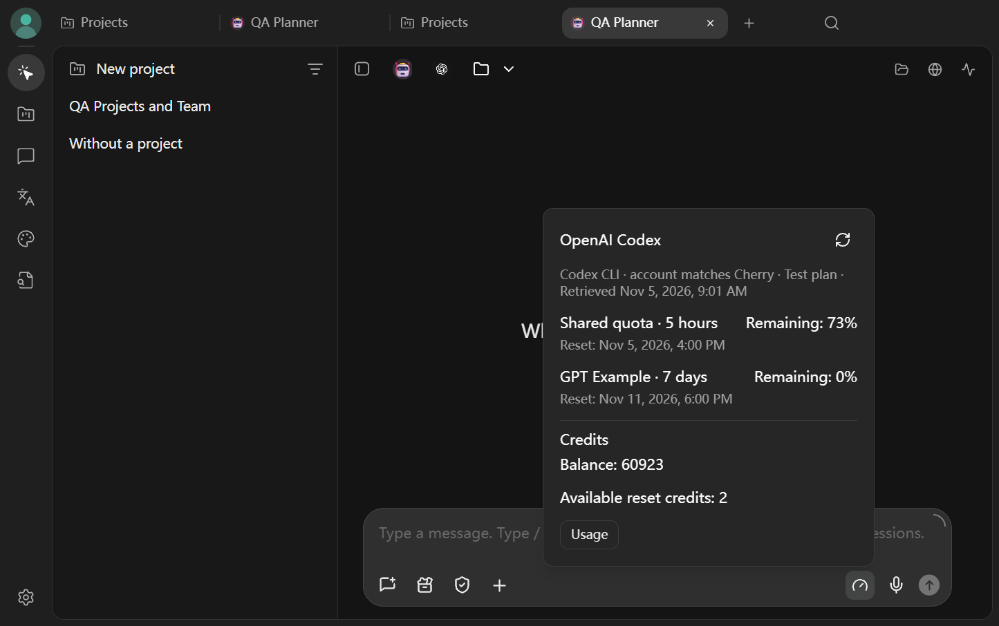

# Was dieser Cherry-Studio-Fork ändert

Dieser Fork basiert auf [Cherry Studio](https://github.com/CherryHQ/cherry-studio). Er ergänzt den gemeinsamen Projektbetrieb, zeigt die vom Konto gemeldeten Nutzungslimits und bietet zusätzliche Möglichkeiten, Daten lokal zu verarbeiten. Die folgenden Änderungen sind in [`main`](https://github.com/Tricade/cherry-studio/tree/main) enthalten. Abschnitte mit dem Hinweis „Vorschau“ zeigen Änderungen aus einem offenen Pull Request.

## Projekte und Agententeams

Unter **Arbeit → Anzeigemodus → Projekte verwalten** legst du ein Projekt an. Wähle den Arbeitsordner, die Agenten für deine Rollen und bei Bedarf gemeinsame Wissensdatenbanken. Vorhandene Agenten kannst du in mehreren Projekten einsetzen. Jedes Projekt hat seine eigenen Chats und sein eigenes Gedächtnis pro Agent.

Starte den Chat mit dem Agenten, der das Team koordinieren soll. Er kann Teammitgliedern Aufgaben geben, ihre Antworten prüfen und Rückfragen stellen. Für Zugriffe auf andere Teamchats gilt der Berechtigungsmodus des jeweiligen Agenten. Der Arbeitsordner und die ausgewählten Wissensdatenbanken gelten für das Projekt.

**Vorschau aus [PR #17](https://github.com/Tricade/cherry-studio/pull/17):** In der linken Leiste gibt es einen eigenen Bereich **Projekte**. Dort kannst du vorhandene Agenten und Wissensdatenbanken auswählen oder neue direkt im Projekt anlegen.

## Kontingente und Guthaben

Unter **Einstellungen → Nutzung → Kontingente und Guthaben des Kontos** kannst du die verfügbaren Werte abrufen. Unterstützt werden OpenAI Codex mit passendem CLI-Konto, Claude Code mit seinem CLI-Profil und CherryIN. Die Anzeige richtet sich nach den gelieferten Daten: gemeinsames oder modellspezifisches Limit, verbrauchter Anteil, nächster Reset und gegebenenfalls Guthaben oder Reset-Gutscheine. Aus Prozenten werden keine Token geschätzt. Die in einem Kontingent enthaltene Nutzung wird getrennt von zusätzlichen Kosten angezeigt.

**Vorschau aus [PR #17](https://github.com/Tricade/cherry-studio/pull/17):** Ein Symbol am Eingabefeld öffnet diese Übersicht für den Anbieter des gerade ausgewählten Agentenmodells. Der Screenshot zeigt Beispielwerte, kein echtes Konto.

## Deutsche Sprachmodelle für den lokalen Betrieb

Unter **Einstellungen → Lokale Modelle** kannst du **Whisper Small INT8 (Deutsch)** für Diktat und **Neon CSS10 (Deutsch)** für die Sprachausgabe herunterladen. Die Modelle benötigen mit ihren jeweiligen Begleitdateien etwa 377 MB bzw. 71 MB. Die Modelldateien werden bei Bedarf heruntergeladen; danach laufen Diktat und Sprachausgabe mit diesen Modellen auf dem Gerät. Das bestehende **PP-OCRv6 Medium** unterstützt auch Deutsch. Downloadquellen und Lizenzen stehen in der Modellansicht.

## Datenschutz und Datenübertragung

- **Diagramme und Symbole:** PlantUML wird lokal gerendert. Die Symbole aus der angepassten Symbolauswahl werden lokal bereitgestellt.
- **Browser:** Die an das Modell übergebenen URL-Felder lassen Zugangsdaten, Abfrageparameter und Fragmente weg. Die Inhalte einer besuchten Seite können weiterhin Daten enthalten.
- **Problem melden:** Wähle die Diagnosedaten aus und sieh dir Inhalt und Ziel an, bevor du die Übertragung bestätigst.
- **Updates:** Die Einstellungen erklären, welche Daten die Updateprüfung überträgt. Die automatische Prüfung lässt sich abschalten.
- **Backups:** Vor dem Start sind der Umfang und das Ziel sichtbar. Beim Übertragen an einen Onlinespeicher weist Cherry Studio darauf hin. Das Vollbackup enthält auch das Projektgedächtnis; das schlanke Backup lässt es aus.

Dieser Fork übernimmt ausgewählte Korrekturen aus dem Original. Details zu offenen Änderungen findest du in den [Pull Requests des Forks](https://github.com/Tricade/cherry-studio/pulls). Die Downloadlinks des Originalprojekts führen zu dessen Versionen. Für diesen Fork gibt es derzeit [kein veröffentlichtes GitHub-Setup](https://github.com/Tricade/cherry-studio/releases).
